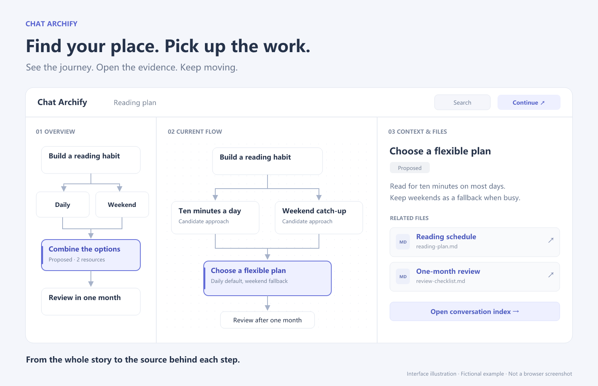
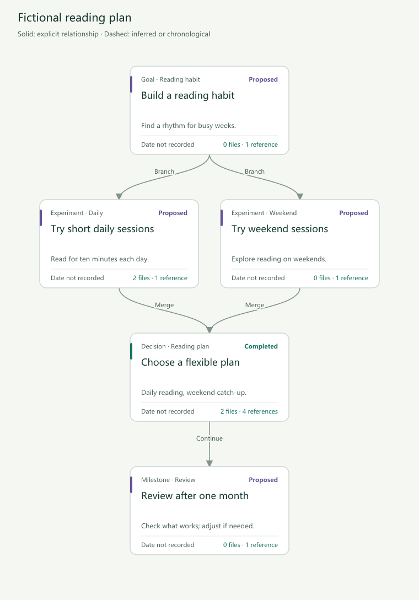

<div align="center">

# Chat Archify

### Long AI chats. A clear path forward.

Turn scattered conversations into a clickable map of **what changed, why it changed, and where the work lives.**

**English** · [简体中文](README.zh-CN.md)

[Download the skill](https://github.com/Wyyyyuu/chat-archify/releases/tag/v0.7.1) · [Try the HTML demo](https://github.com/Wyyyyuu/chat-archify/releases/download/v0.7.1/chat-archify-demo.html) · [How it works](#from-conversation-to-context)

**One full version · Offline HTML · Use only when you ask**

</div>



*Interface illustration using the included fictional reading-plan example, not a browser screenshot. Download the HTML above and open it locally to explore the actual interactive version.*

## Keep the context. Keep building.

You built something with AI. Then the chat grew, files multiplied, and the plan changed. A week later: which version worked? Why was that approach dropped? Which file matters now?

Chat Archify is a skill for answering those questions. It turns the available conversation history into a navigable project record, with evidence and outputs attached to the steps that produced them. Built for people learning to build with AI; useful for any long-running discussion.

| When you need to… | Chat Archify helps you… |
| --- | --- |
| Understand an unfamiliar project | Follow a compact overview, then open one stage at a time. |
| Find the reason behind a change | Trace decisions, alternatives, failed attempts, and unfinished work back to the saved conversation. |
| Find the right file | See a short purpose label, read rendered Markdown, or download an eligible embedded file. |
| Switch to another AI | Export a continuation pack with the current state, constraints, key files, and next goal. |
| Update the record | Reuse valid summaries and review additions, changes, and removals before applying a candidate. |

## From conversation to context

**1. Start with the map.** See the overall path without reading the entire transcript. Open a stage to explore its flow; resize the three panels to suit the task.

**2. Open the evidence.** Select a node for a short explanation and relevant resources. Read saved questions and answers in an in-page conversation reader. Return from a file without losing the expanded record and reading position.

**3. Continue with context.** Export a handoff for another AI, or update the existing map after more work. Stable identities keep records connected; unchanged summaries do not need to be generated again.



*English translation of the basic-renderer export: one goal, two candidate approaches, a combined plan, and a future review. The full HTML adds the workspace, file reader, conversation index, and handoff tools. “Proposed” is deliberately not presented as “verified.”*

### More than a diagram

- **Files with meaning:** short descriptions and purpose-based groups; no wall of per-file code diffs by default.
- **Traceable conversations:** question-based index titles, in-page question/answer reading, search, and manual links between a conversation and a module.
- **Collection receipts:** where supported, collect readable active and archived Codex chats with pagination, checkpoints, and explicit gaps. Other hosts can use user-provided exports.
- **Incremental summaries:** content-bound reuse, append-only updates, and reversible references for exactly repeated text. Eligible original text stays available; important events are not removed by keyword filtering.
- **Reviewable changes:** compare a previous map with a candidate. Approval is bound to those exact inputs; changes are not silently applied.
- **Portable output:** one self-contained HTML for browsing, plus structured records for editing. No account or hosted viewer is required to open it.

## Try it in two minutes

1. [Download the fictional demo](https://github.com/Wyyyyuu/chat-archify/releases/download/v0.7.1/chat-archify-demo.html) and open it in a modern desktop browser. GitHub provides a file download, not a running HTML app.
2. Click a stage, then **合并为弹性阅读计划**. Explore its explanation and linked files.
3. Open **打开对话索引** to read the saved messages. Try **续聊包** to prepare a handoff.

The example contains six synthetic messages, five nodes, and four Markdown resources. It contains no real user chat. The current viewer and example labels are primarily Chinese; this documentation is bilingual.

## Install and use

Download `chat-archify.zip` from the [v0.7.1 release](https://github.com/Wyyyyuu/chat-archify/releases/tag/v0.7.1). Extract the `chat-archify` folder into your host's skills directory. In Codex, that is normally `~/.codex/skills/`; restart or reload skills if needed.

**The repository, archive, installation folder, and skill invocation now all use `chat-archify`.** There is one full public version, with no feature tiers, purchase, or license key required. When upgrading from a formerly named edition, back up and remove its old folder from the active skills directory, then install `chat-archify` and use `$chat-archify`. Keep your generated HTML and project records; they do not need to be recreated.

Generation requires **Python 3.9+**, **Node.js 18+**, and a separately installed [Archify](https://github.com/tt-a1i/archify) runtime. The integration was tested with Archify `2.17.0-dev.1`. The generated HTML needs only a browser with JavaScript enabled. Your AI host supplies the model; this repository does not include an LLM API or credits.

Then ask your AI:

```text
Use $chat-archify to organize this project's available conversations.
Show the main stages, key decisions, failed approaches, and unfinished work.
Attach relevant files with a short explanation of their purpose.
Generate a local interactive HTML and report gaps in the source coverage.
```

No code repository? Try:

```text
Use $chat-archify to map this long conversation.
Show topics, alternatives, decisions, and open questions.
There are no project files; leave resources empty where none exist.
```

Later:

```text
Update the existing map using the new conversation.
Reuse unchanged summaries, preserve previous decisions and failed approaches,
and prepare a candidate for review before applying it.
```

The skill runs only when explicitly requested. It does not monitor chats in the background.

## Reproduce the example

Run from the installed skill directory, replacing the Archify path:

```sh
python scripts/build_interactive_demo.py --archify-dir "/path/to/archify" --out-dir "demo-output"
```

Open `demo-output/chat-archify-demo.html`. The command builds the example and runs the included programmatic checks. For a plain conversation without project files:

```sh
python scripts/build_plain_demo.py --archify-dir "/path/to/archify" --out-dir "plain-demo"
```

Details: [skill workflow](SKILL.md) · [record format](references/graph-format.md) · [collection](references/automatic-collection.md) · [summary reuse](references/incremental-summaries.md) · [continuation and reviews](references/continuation-and-updates.md).

## What to expect

This is a **public preview**, with automated packaging, route, indexing, collection, and summary checks. Full real-browser acceptance is still pending; [the checklist](references/browser-acceptance.md) states what remains to verify. The images above do not imply browser acceptance has passed.

Coverage depends on what the host can actually expose. Unreadable messages, missing attachments, and unverified claims remain visible gaps; inaccessible history cannot be guaranteed recoverable. Collection, model reading, and diagram linking are tracked separately.

Output stays local unless you share it. **Sharing the HTML also shares embedded conversations and file snapshots.** Common credential filtering and a 25 MiB per-file limit help bound inclusion, but review outputs before publishing. Markdown uses bundled [Marked](assets/vendor/marked-LICENSE.md); raw HTML is not executed and remote images are not automatically fetched.

## Help shape Chat Archify

Try it on a messy discussion or a project you have not touched for a while. [Open an issue](https://github.com/Wyyyyuu/chat-archify/issues) with the confusing step, expected behavior, and a small synthetic example. Avoid uploading private conversations or credentials.

If it helps you return to a project with confidence, a star helps other AI builders find it.
