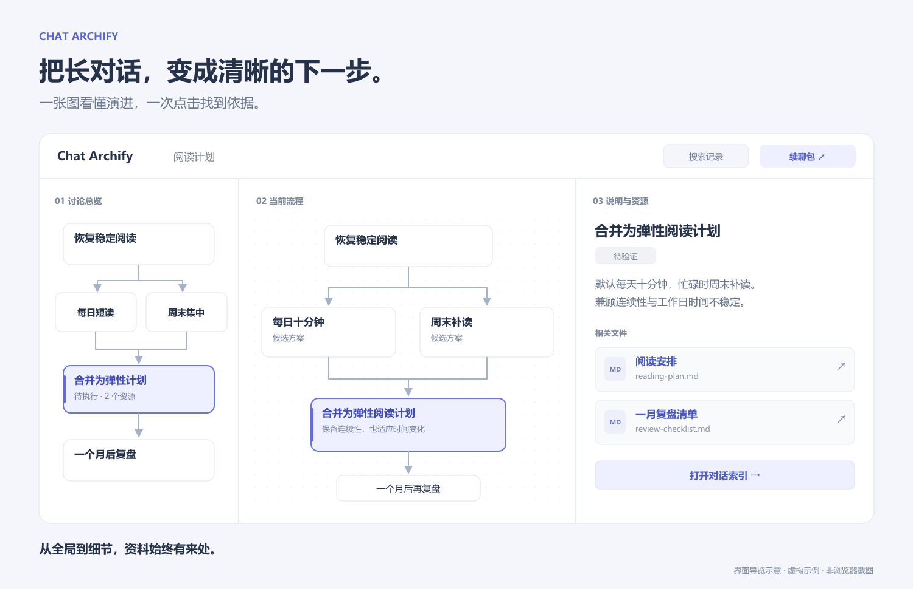
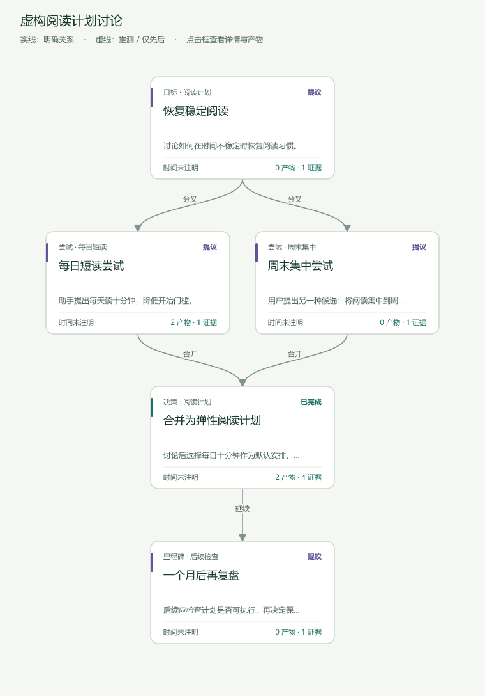

<div align="center">

# Chat Archify

### 聊天再长，也能看清项目走到了哪一步。

把零散的 AI 对话整理成可点击的脉络图：**做了什么、为什么这样改、文件在哪里、下一步做什么。**

[English](README.md) · **简体中文**

[下载完整 Skill](https://github.com/Wyyyyuu/chat-archify/releases/tag/v0.8.0) · [体验 HTML 示例](https://github.com/Wyyyyuu/chat-archify/releases/download/v0.8.0/chat-archify-demo.html) · [了解使用效果](#从聊天记录到项目脉络)

**完整版本公开 · HTML 离线阅读 · 仅在你要求时运行**

</div>



*使用随包虚构阅读计划制作的界面导览示意，并非浏览器截图。下载上方 HTML，在本地打开即可体验实际交互页面。*

## 让你接得上之前的工作

用 AI 做项目，聊着聊着就开了多个窗口，改了很多文件，也换过几次方案。过了一周再回来：现在到底做到了哪里？为什么放弃那个方案？应该从哪个文件继续？

Chat Archify 就是为这些时刻准备的 Skill。它把可读取的对话和项目记录，整理为带来源、带产物、可以继续更新的交互页面。尤其适合正在学习用 AI 做项目的人，也适合没有代码文件的普通长对话。

| 你想知道 | 页面帮你找到 |
| --- | --- |
| 这个项目是怎么做起来的？ | 先看紧凑总览，再逐步进入具体阶段。 |
| 为什么改成了现在的方案？ | 关键决策、备选方案、失败转向，以及对应的已保存对话。 |
| 哪个文件有用，怎么打开？ | 简短用途说明、排版后的 Markdown，以及可下载的合规文件快照。 |
| 换一个 AI，还要从头解释吗？ | 导出续聊包，带上当前状态、限制、关键文件和下一步目标。 |
| 之后又改了很多，怎么办？ | 复用有效摘要；先审查新增、修改和删除，再应用候选版本。 |

## 从聊天记录到项目脉络

**先看图。** 总览说明整个过程，点击一个阶段再看内部流程。三个区域可以调整宽度，阅读时只关注当前需要的内容。

**再看依据。** 点选节点，查看简短说明和相关文件。对话索引在页面内展示问题与回答；打开文件再返回，保留已展开的记录和阅读位置。

**带着上下文继续。** 把当前阶段整理成续聊包，交给另一个 AI；或者在后续工作后更新同一张图，复用未变化的摘要。



*基于基础渲染器导出制作的静态配图：一个目标、两个候选方向、合并后的计划和后续复盘。下载 HTML 示例即可点击节点，体验工作台、文件阅读、对话索引与续聊工具。「计划提出」不会被写成「效果已验证」。*

### 图只是入口，资料也能顺着找到

- **界面中英可切换：** 当前节点、文件、展开状态和对话阅读位置保持不变。
- **文件有说明：** 用简短用途和功能分组解释产物，默认不堆满逐文件代码差异。
- **对话可追溯：** 索引标题优先显示本轮问题，支持页内问答阅读、搜索，以及对话与模块的手动关联。
- **来源有覆盖记录：** 宿主支持时，采集可读的活动／归档 Codex 对话，处理分页和断点恢复；其他平台可使用用户提供的导出。
- **摘要可复用：** 按内容校验缓存，只处理新增或变化的部分；完全重复的正文使用可还原引用，保留合规原文，不按关键词删掉重要事件。
- **更新可审查：** 对比旧页面和候选版本，批准绑定到这两份具体文件，不静默覆盖记录。
- **结果可带走：** 一个可离线阅读的 HTML，加上可继续编辑的结构化记录；打开页面不需要账号或托管服务。

## 两分钟体验

1. [下载虚构示例 HTML](https://github.com/Wyyyyuu/chat-archify/releases/download/v0.8.0/chat-archify-demo.html)，用现代桌面浏览器打开。GitHub 提供文件下载，不会直接运行 HTML。
2. 点击阶段，再选择 **合并为弹性阅读计划**，查看说明和关联文件。
3. 点击 **打开对话索引** 阅读消息，再试试 **续聊包**，准备一份交接资料。

示例包含六条合成消息、五个节点、四份 Markdown 资源，不含真实用户对话。此入口默认中文；顶栏可切换中文／English，并保留阅读位置。原始对话与文件正文保持原语言。[英文示例](https://github.com/Wyyyyuu/chat-archify/releases/download/v0.8.0/chat-archify-demo-en.html) 使用英文合成内容，默认英文界面。

## 安装与使用

从 [v0.8.0 发布页](https://github.com/Wyyyyuu/chat-archify/releases/tag/v0.8.0) 下载 `chat-archify.zip`，将其中的 `chat-archify` 文件夹解压到宿主的 skills 目录。Codex 通常使用 `~/.codex/skills/`；必要时重启或重新加载 Skill。

**仓库、压缩包、安装目录和 Skill 调用名现已统一为 `chat-archify`。** 只有一个完整公开版本，不区分功能档位，不需要购买或授权码。从旧命名版本升级时，先备份并将旧文件夹移出启用的 skills 目录，再安装 `chat-archify`，使用 `$chat-archify` 调用。已生成的 HTML 和项目记录继续保留，无需重新整理。

生成完整页面需要 **Python 3.9+**、**Node.js 18+**，以及另行安装的 [Archify](https://github.com/tt-a1i/archify) 运行时；当前集成测试使用 `2.17.0-dev.1`。生成后的 HTML 只需启用 JavaScript 的浏览器即可阅读。AI 模型由宿主提供，本仓库不包含模型 API 或额度。

安装后，可以直接这样说：

```text
使用 $chat-archify 梳理这个项目能读取的相关对话。
展示主要阶段、关键决策、失败转向和未完成事项，
为相关文件写一句用途说明，生成本地交互 HTML。
同时告诉我来源覆盖范围，以及仍然缺少哪些内容。
```

普通长对话也可以：

```text
使用 $chat-archify 整理这段长对话。
按话题、备选方案、决定和待确认问题生成脉络图。
没有项目文件，缺少资源的地方留空即可。
```

后续更新时：

```text
根据新对话更新已有脉络图，复用未变化的摘要。
保留之前的决定和失败转向，先生成候选版本供我审查。
```

Skill 仅在明确要求时运行，不在后台监控你的聊天。

## 自己生成示例

在安装后的 Skill 目录运行，将 Archify 路径替换为自己的安装位置：

```sh
python scripts/build_interactive_demo.py --archify-dir "/path/to/archify" --out-dir "demo-output"
```

打开 `demo-output/chat-archify-demo.html`。这条命令会生成示例，并执行随包程序检查。加上 `--language en` 可生成默认英文的 `chat-archify-demo-en.html`，其中的虚构对话与附件也使用英文。没有项目文件的普通长对话示例：

```sh
python scripts/build_plain_demo.py --archify-dir "/path/to/archify" --out-dir "plain-demo"
```

进一步了解：[Skill 工作流](SKILL.md) · [记录格式](references/graph-format.md) · [自动采集](references/automatic-collection.md) · [摘要复用](references/incremental-summaries.md) · [续聊与审查](references/continuation-and-updates.md)。

## 当前状态与边界

当前为**公开预览版**，已有打包、连线、索引、采集和摘要等程序检查；完整的真实浏览器验收仍待补齐，[检查清单](references/browser-acceptance.md) 列出了待验证的交互。上述配图不代表浏览器验收已经通过。

能整理多少，取决于宿主实际能提供多少。不可读取的消息、缺失附件和未验证结论会保留为缺口，不承诺找回无法访问的历史。采集完成、模型读过和图中已关联会分别记录。

内容默认留在本地。**分享 HTML，也会分享其中嵌入的对话和文件快照。** 常见凭据过滤与单文件 25 MiB 限制帮助控制收录范围，但公开前仍应检查产物。Markdown 使用随包的 [Marked](assets/vendor/marked-LICENSE.md)，不执行原始 HTML，不自动加载远程图片。

## 一起把它做得更好

可以拿一段复杂讨论，或者一个搁置了一阵的项目试试。如果某一步难理解，欢迎[提交 Issue](https://github.com/Wyyyyuu/chat-archify/issues)，说明实际表现、预期效果，并尽量提供小型虚构示例，不上传私人对话或凭据。

如果它帮你接上了之前的工作，欢迎点一颗 Star，让更多用 AI 做项目的人发现它。
